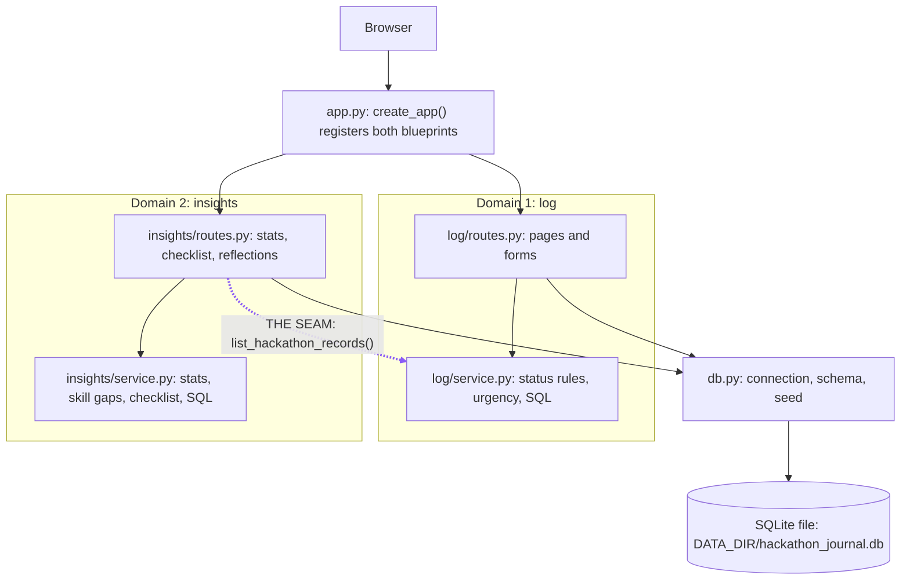

The dotted arrow is the seam. Insights imports exactly one thing from log: `list_hackathon_records()`, which returns a list of plain dictionaries (each with its projects and teammates, including the hackathon `id`). Log never imports insights.